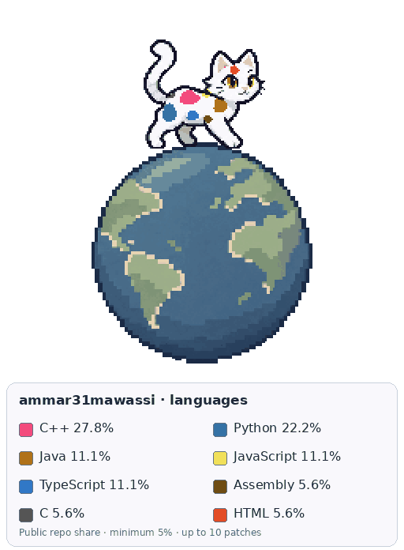
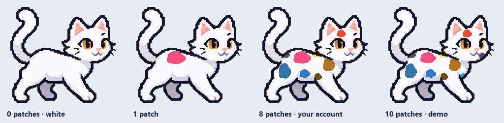

<p align="center">
  
</p>

# Git Cat

A pixel cat that wears your GitHub languages and walks on a miniature globe. It generates a transparent looping GIF with a built-in color key for your profile README.

Each language with **at least 5%** of your eligible public repositories gets a patch, up to **10 patches**. An account with no qualifying languages gets a white cat. The legend shows each language's GitHub color and its original percentage.

## How the percentages work

Each distinct public, non-fork repository you own gets one vote for its primary language. Repositories without a primary language are excluded. This measures repository composition, not lines of code or time spent coding.

Selection uses the exact share before rounding: 5% qualifies, 4.95% does not. If more than ten languages qualify, the ten most common are selected, with alphabetical ties. The displayed percentages retain the original denominator; filtered languages do not inflate another language's share. Patches are illustrative spots, not an exact area chart.

## Use it

Requires Python 3.12+, [GitHub CLI](https://cli.github.com/), and an authenticated GitHub account for collecting public data.

```sh
python -m pip install -r requirements.txt
gh auth login
python generate_cat.py --login YOUR_USERNAME --refresh
```

The output appears in `generated/`:

- `YOUR_USERNAME-cat-with-legend.gif` — cat, globe, language colors, and percentages.
- `YOUR_USERNAME-cat-globe.gif` — animation without the legend.
- `language-legend.png` — separate color key.
- `preview.html` — animated light/dark previews.
- `github-snapshot.json` and `personalization.json` — public source observations and selection details.

To reproduce the last snapshot without an API request:

```sh
python generate_cat.py --login YOUR_USERNAME
```

Use `--output-dir PATH` for a different destination or `--snapshot PATH` to load a saved collection.

## Add it to your profile

For Ammar's generated cat:

```html
<a href="https://github.com/ammar31mawassi/git-cat">
  
</a>
```

For your own automatically refreshed cat, fork this repository, enable Actions, and run **Refresh coding cat** once. The workflow uses the repository owner's username and its built-in GitHub token; no personal token secret is required. Change the owner and filename in your README image URL to match your fork.

The workflow runs daily at **03:25 UTC**, can run manually, and also runs when the generator, tests, assets, requirements, or workflow change. GitHub schedules can be delayed. A successful refresh commits the current GIF and public-data snapshot; an API or render failure keeps the previously published version. README image caching can delay visible updates.

## Examples



The zero-, one-, and ten-patch cases are demonstrations. The eight-patch example came from Ammar's account at generation time; the current result may change as repositories are added.

## Development

```sh
python -m unittest test_coat.py -v
```

Checks cover the exact 5% boundary, rounding, the ten-patch limit, empty accounts, forks and duplicate repositories, the untouched white fallback, and visibility of all ten patch slots across the eight walk poses.

The walk contains eight poses, repeated over one 6.4-second globe revolution. The generator uses fixed body coordinates so the spots stay attached to the cat. It preserves the source alpha, uses nearest-neighbor scaling, and reserves language swatch colors in the GIF palette. The GIF moves within its image rectangle.

## Artwork and inspiration

The original cat, corrected leg cycle, white template, and globe were created with OpenAI's image-generation tool. The included templates are sufficient to render future cats without an image-generation API or API key. Generation prompts are in [docs/prompts](docs/prompts).

Inspired by [git-koi](https://github.com/yalongwastaken/git-koi)'s idea of turning GitHub activity into a personal README companion. This repository contains its own Python generator and original cat/globe assets.

MIT licensed. Created by [Ammar Mawassi](https://github.com/ammar31mawassi).
